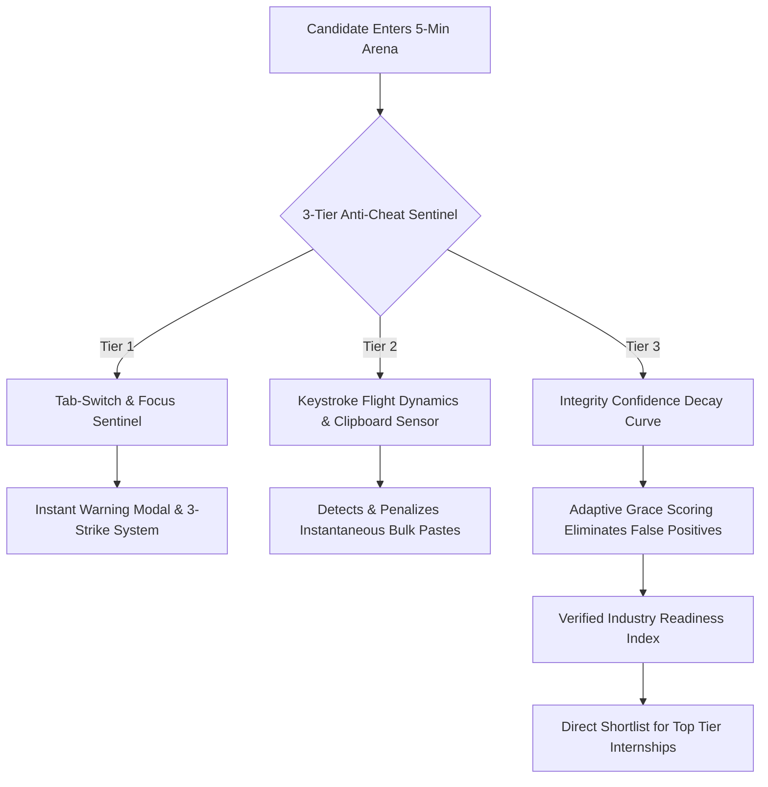

# ⚡ InternForge — 3-Tier Anti-Cheat Micro-Task Platform

> **The next-generation internship assessment & verification platform that eliminates the ChatGPT-4o cheating loophole.**  
> Powered by **Contextual Micro-Tasks**, **3-Tier Anti-Cheat Sentinels**, **Live ATS Resume Diagnostics**, and **Industry Readiness Index (IRI)**.

[](https://vitejs.dev/)
[](https://react.dev/)
[](https://threejs.org/)
[](LICENSE)

---

## 🎯 The Core Problem: Why Traditional Platforms are DEAD

Traditional assessment platforms like **HackerRank** and **Unstop** ask generic LeetCode algorithms (*"Reverse a Linked List"*, *"Two Sum"*), which can be solved instantly using ChatGPT-4o or Copilot. 

As a result:
* **Recruiters** waste hundreds of engineering hours interviewing candidates who cheated on online assessments.
* **Deserving Students** lose opportunities to candidates with inflated, AI-generated test scores.

---

## 🛡️ The Solution: The 3-Tier Anti-Cheat Sentinel



1. **Tier 1: Focus & Tab-Switch Sentinel**
   * Uses HTML5 `visibilitychange` & `window.blur` listeners.
   * Switching tabs to open ChatGPT triggers immediate warning toasts and strike counter increments (3 strikes flags submission).
2. **Tier 2: Keystroke Flight Dynamics & Clipboard Guard**
   * Tracks delta timestamp between keydown events (`150ms–250ms` natural human cadence).
   * External mobile prompt copying or clipboard bulk pastes (>40 chars) trigger an instantaneous anomaly penalty.
3. **Tier 3: Integrity Confidence Decay Curve**
   * Eliminates false positives from accidental mouse slips via progressive decay rather than instant disqualification.
4. **Contextual Production Sandboxes (No LeetCode)**
   * Candidates fix real multi-file production glitches (React state closures, JWT clock skew edge cases, EventBus memory leaks).

---

## ✨ Key Features

* **💼 Department-Wise Verified Internship Matrix:**
  * 8 Departments (Frontend, Backend, AI/ML, DevOps, Cyber, Data, UI/UX, Product).
  * Direct bounties and stipends (₹55k - ₹85k / mo) with verified direct micro-test entry.
* **📄 Contextual ATS Resume Scanner:**
  * Live parsing engine scoring resumes from 0 to 100.
  * Quantified metrics scanner, action verb density, and department match percentage.
  * One-click candidate presets (*Frontend Pro, Backend Pro, Generic Fresher*) for instant demonstrations.
* **⚡ 5-Minute Hyper-Time-Boxed Micro-Arena:**
  * Ticking urgent countdown timer (turning red at 0:59).
  * In-browser sandboxed test runner with real unit tests and confetti celebrations.
  * Live Judge Simulation Bar to trigger anti-cheat reactions on-demand.
* **📊 Industry Readiness Index (IRI) & Roadmaps:**
  * Diagnostic composite score (0-100).
  * Verified strengths vs identified weak points.
  * 3-stage curated learning roadmaps with official documentation links for each gap.
* **🤖 ForgeAI Copilot & Autonomous Chatbot:**
  * Floating holographic assistant with Web Speech API audio narration.
  * In-app automated navigation, pitch coaching, and contextual hints.
* **🌌 3D Holographic Core & Sound Synthesizer:**
  * Three.js particle nebula and rotating cybernetic wireframe core.
  * Web Audio API synthesized sounds (clicks, alarms, victory chimes) with mute toggle.

---

## 🛠️ Tech Stack

* **Frontend:** React 19, JavaScript (ES6+), Vite
* **3D Visuals:** Three.js (WebGL Canvas)
* **Audio Engine:** Pure Browser Web Audio API Synthesizer
* **Aesthetics:** Custom Vanilla CSS Design System (Cyberpunk Glassmorphism)
* **Effects:** Canvas Confetti

---

## 🚀 Getting Started

### Prerequisites
* Node.js v18+ or v20+
* npm or pnpm

### Installation

```bash
# Clone the repository
git clone https://github.com/Anubhav1451/Internforge.git

# Navigate into project directory
cd Internforge

# Install dependencies
npm install

# Start development server
npm run dev
```

Open [http://localhost:5173/](http://localhost:5173/) in your browser.

### Production Build

```bash
npm run build
npm run preview
```

---

## 🏆 Hackathon Winning Battle Cards

| Counter-Question | Winning Response |
| :--- | :--- |
| **"HackerRank aur Unstop se alag kya hai?"** | We test **Live Contextual Bug Fixing** (state closures, API drift), not generic LeetCode syntax that ChatGPT-4o solves in 1 second. |
| **"Agar mobile phone se dekh kar cheat kare?"** | **Hyper-Time-Boxing (5 min limit)** leaves zero time to prompt + read, and **Keystroke Flight Dynamics** detects abnormal cadence from transcription. |
| **"Mouse bahar gaya toh kya disqualify ho jayega?"** | No, our **Integrity Confidence Decay Curve** provides 3-tier grace tolerance. Instant penalties only apply on sustained focus loss + bulk mutation. |
| **"Companies toh Copilot use karti hain?"** | That's our masterstroke! We don't forbid AI; we test if the developer can comprehend messy production context and debug in 3 minutes! |

---

## 📄 License
MIT © 2026 InternForge
